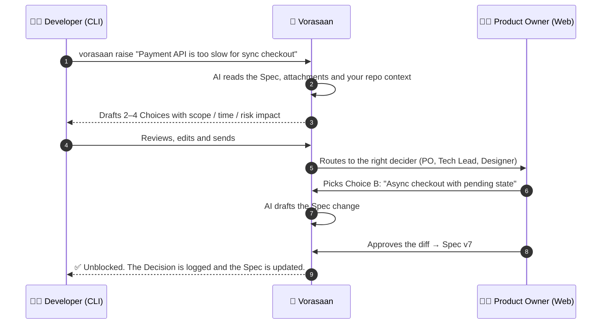

<div align="center">

# 🐘 Vorasaan

### The open-source alignment engine for software teams

**AI proposes. Humans approve. Your coding agent builds the right thing.**

[](https://github.com/gameprem/Vorasaan/actions/workflows/ci.yml)
[](./LICENSE)
[](#-roadmap)
[](https://bun.sh)
[](#-contributing)

[How it works](#-how-it-works) · [Features](#-features) · [Getting started](#-getting-started) · [Architecture](#-architecture) · [Roadmap](#-roadmap) · [Contributing](#-contributing)

</div>

---

> [!WARNING]
> **Vorasaan is in early development.** The design is settled and the foundation is in place, but the product is not usable yet. Star and watch the repo to follow along, or jump in and help build it.

## 🤔 Why Vorasaan?

AI coding assistants are fast. They are also confidently wrong when the spec is vague.

The real bottleneck isn't writing code. It's the gap between what the business meant and what engineering understood. On most teams, that gap gets filled by:

- 🧵 Slack threads that go on for days while a developer waits,
- 📄 Jira tickets and Confluence pages that drifted out of date weeks ago,
- 🤖 AI agents that fill in the blanks with plausible-looking guesses.

**Vorasaan** (วรสาร, Thai for *"journal"*) closes that gap. When anyone on the team hits an open question, Vorasaan turns it into a **one-click decision** for the right person. Then it updates a **versioned, human-approved Spec** that your coding agent can trust.

## ⚙️ How it works



Every decision is recorded, every Spec change is a reviewed diff, and nothing an AI writes becomes truth until a human with the right role approves it.

## ✨ Features

| | |
| --- | --- |
| 🎯 **Choice Engine** | Blockers and questions become 2–4 concrete options with impact on scope, time and risk. No more open-ended threads. |
| 🧭 **Smart routing** | Business questions go to the PO, technical ones to the Tech Lead, UX to the Designer. Supports delegation while people are on leave. |
| 📜 **Versioned Specs** | Markdown Specs with Confluence-style version history, diffs, and one-click revert. |
| 🗂️ **Decision Log** | Every decision is traceable: who decided, what the alternatives were, and which Spec version it produced. |
| 📎 **One place for context** | Attach Confluence pages, Jira epics, files and URLs. Vorasaan snapshots them so the AI reasons over real context. |
| 💻 **Terminal-native** | `vorasaan` is a live TUI inbox for developers, with OS notifications. Raise and answer without leaving your editor. |
| 🤝 **Agent handoff** | `vorasaan run --ai claude` hands your coding agent the approved Spec, not a guess *(planned)*. |
| 🏠 **Self-hosted** | Your data stays on your infrastructure. Bring your own LLM key (Anthropic by default, or any OpenAI-compatible endpoint). |

## 🚀 Getting started

> Self-hosting with a single `docker compose up` is coming with the first release. For now, you can run the development environment.

### Prerequisites

- [Bun](https://bun.sh) ≥ 1.4
- [Docker](https://www.docker.com/) (for PostgreSQL)

### Development setup

```bash
git clone https://github.com/gameprem/Vorasaan.git
cd Vorasaan

cp .env.example .env          # then fill in the values
docker compose up -d db       # PostgreSQL 17
bun install
bun run db:generate           # generate the Prisma client
bun run db:migrate            # apply database migrations
```

### Useful commands

| Command | What it does |
| --- | --- |
| `bun run lint` | Lint and format-check with Biome (`bun run format` to fix) |
| `bun run typecheck` | Type-check every workspace |
| `bun run test` | Run the test suites |
| `docker compose --profile router up` | Also start [9Router](https://github.com/decolua/9router), an optional LLM router |

## 🏗️ Architecture

```
vorasaan/
├── apps/
│   ├── web/        Next.js 16 · Tailwind · shadcn/ui · BlockNote
│   ├── server/     NestJS 12 (Fastify) · Mastra agent workflows
│   └── cli/        Commander · Ink TUI · single binary via bun build --compile
├── packages/
│   ├── db/         Prisma 7 schema, migrations and client
│   ├── shared/     Zod schemas: the single API contract
│   └── skills/     Prompt templates per team and role
└── docs/adr/       Architecture Decision Records
```

**Tech stack:** Bun · TypeScript · Turborepo · NestJS · Next.js · Mastra · Prisma · PostgreSQL · Zod · Biome

Key decisions are documented as ADRs:

- [0001: Vorasaan, not Confluence, is the source of truth](./docs/adr/0001-vorasaan-is-the-source-of-truth.md)
- [0002: Markdown is the canonical Spec format](./docs/adr/0002-markdown-is-the-canonical-spec-format.md)
- [0003: Mastra runs as a library inside NestJS](./docs/adr/0003-mastra-as-a-library-inside-nestjs.md)
- [0004: Zod schemas are the only API contract](./docs/adr/0004-zod-is-the-only-api-contract.md)
- [0005: Bun is the runtime, package manager and test runner](./docs/adr/0005-bun-as-runtime-and-package-manager.md)

The domain language (Feature, Spec, Decision Request, Decider, and so on) is defined in [`CONTEXT.md`](./CONTEXT.md). The full product requirements are in [`REQUIREMENT.md`](./REQUIREMENT.md).

## 🗺️ Roadmap

- [x] Product design, domain model and glossary
- [x] Monorepo foundation, database schema and CI
- [ ] **Tracer bullet:** raise → AI Choices → decide → approved Spec version
- [ ] **MVP:** onboarding, attachments, routing, delegation, inbox, TUI
- [ ] `vorasaan run --ai claude`: hand the approved Spec to your coding agent
- [ ] **Grilling workflow:** structured PO → Designer → Dev questioning that produces the first Spec
- [ ] **Design flow revisions** with cascade impact analysis
- [ ] Jira / Confluence write-back, and Figma and Google Docs connectors

## 🤝 Contributing

Contributions are welcome, from bug reports and design feedback to code.

1. Read [`CONTEXT.md`](./CONTEXT.md) so we all speak the same language.
2. Skim the [ADRs](./docs/adr/) before proposing architectural changes.
3. Pick up an open ticket, and keep one change per pull request.
4. Make sure `bun run lint`, `bun run typecheck` and `bun run test` pass.

A full `CONTRIBUTING.md` will land with the first release.

## 📄 License

Vorasaan is licensed under the [GNU Affero General Public License v3.0](./LICENSE). You're free to use, modify and self-host it. If you offer a modified version as a network service, you must share your changes under the same license.

<div align="center">
<br />
<sub>Built with ❤️ for teams who'd rather decide once than debate forever.</sub>
</div>
