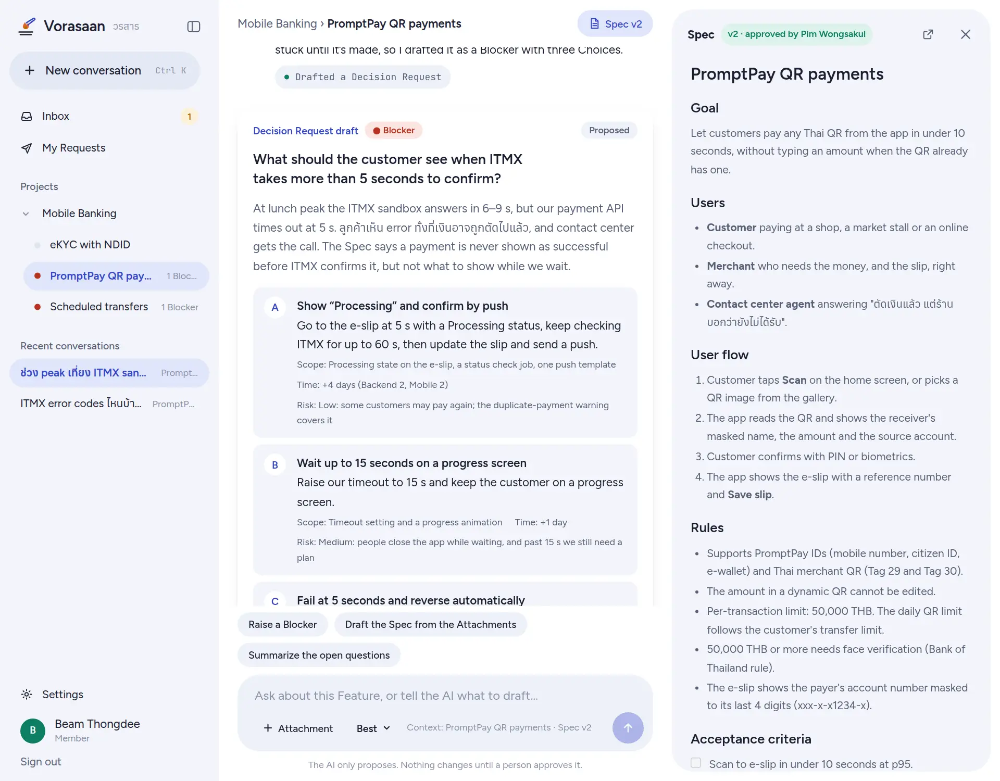
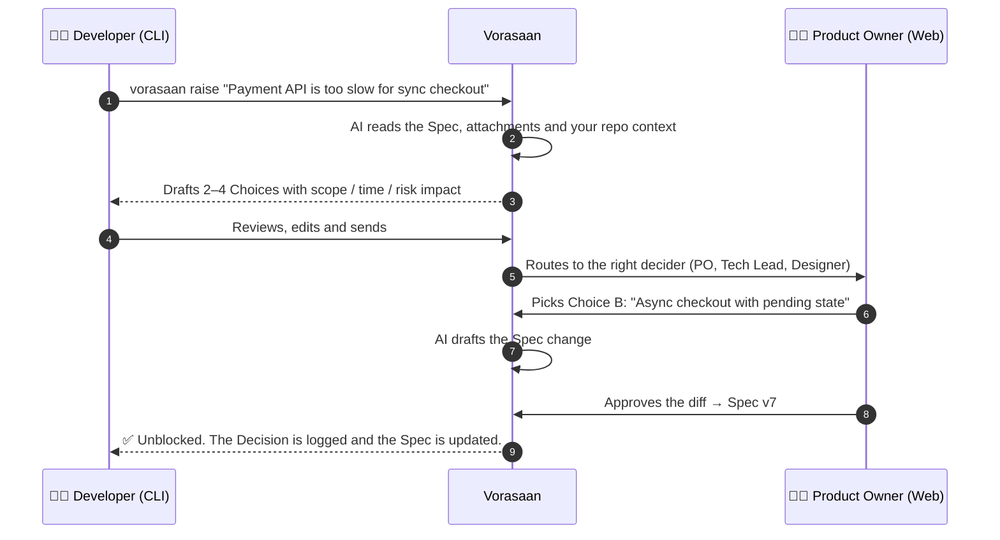
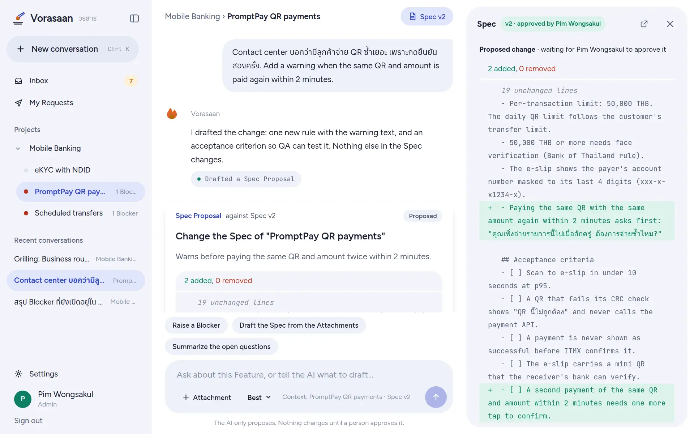
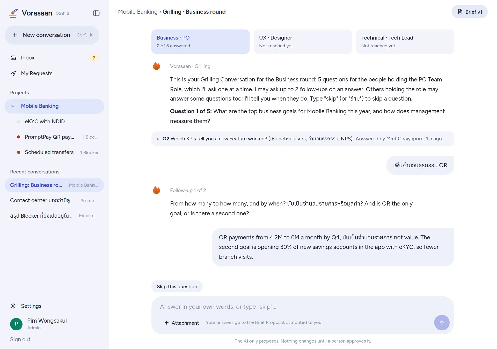
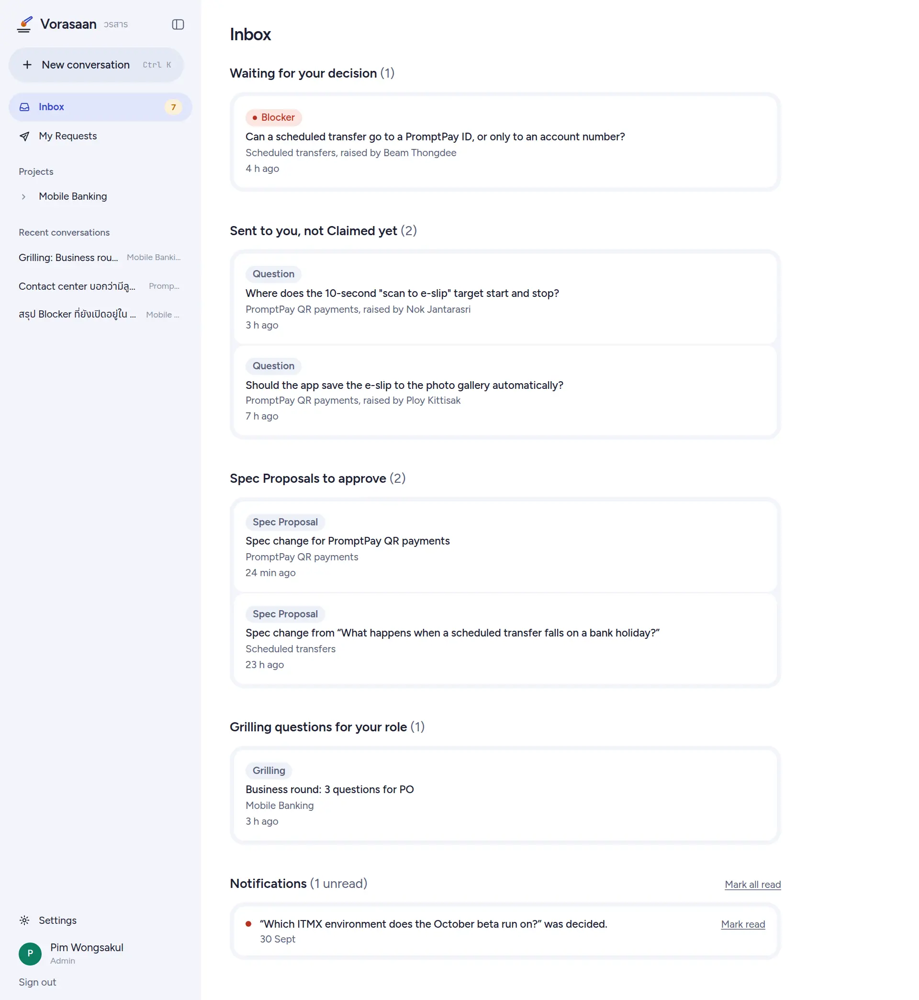
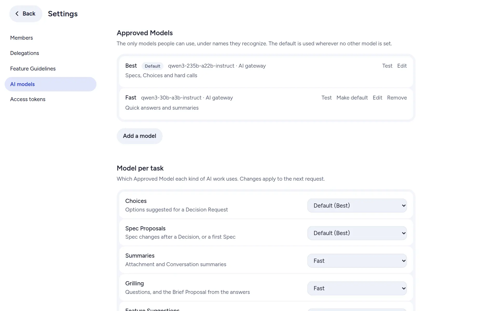
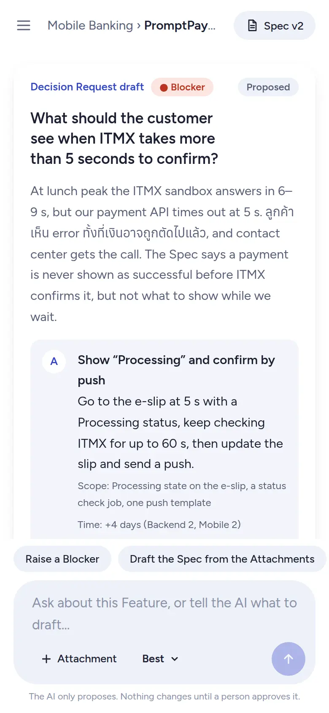
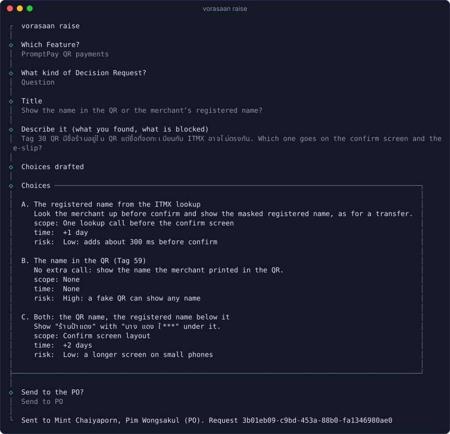
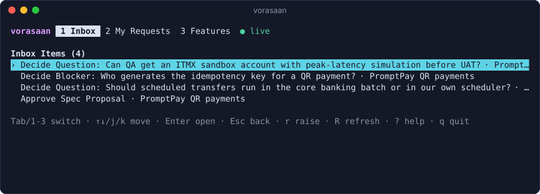
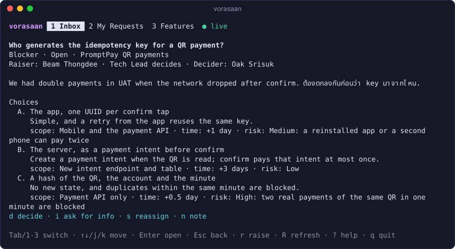

<div align="center">

#  Vorasaan

### The open-source alignment engine for software teams

**AI proposes. Humans approve. Your coding agent builds the right thing.**

[](./LICENSE)
[](#-roadmap)
[](https://bun.sh)
[](#-contributing)

[How it works](#-how-it-works) · [Features](#-features) · [Getting started](#-getting-started) · [Architecture](#-architecture) · [Roadmap](#-roadmap) · [Contributing](#-contributing)

</div>

<br />

<picture>
  <source media="(prefers-color-scheme: dark)" srcset="docs/images/conversation-dark.webp" />
  
</picture>

<p align="center"><sub>A developer asks about a timeout in a <b>Feature Conversation</b>. The AI drafts a <b>Blocker</b> with three <b>Choices</b> as an <b>Action Card</b>; nothing is sent until they press Send. The approved <b>Spec</b> sits beside the chat.</sub></p>

---

> [!WARNING]
> **Vorasaan is in early development.** You can install it and run the core loop end to end, but many MVP features are still missing. Star and watch the repo to follow along, or jump in and help build it.

## 🤔 Why Vorasaan?

AI coding assistants are fast. They are also confidently wrong when the spec is vague.

The real bottleneck isn't writing code. It's the gap between what the business meant and what engineering understood. On most teams, that gap gets filled by:

- 🧵 Slack threads that go on for days while a developer waits,
- 📄 Jira tickets and Confluence pages that drifted out of date weeks ago,
- 🤖 AI agents that fill in the blanks with plausible-looking guesses.

**Vorasaan** (วรสาร, Thai for *"journal"*) closes that gap. When anyone on the team hits an open question, Vorasaan turns it into a **one-click decision** for the right person. Then it updates a **versioned, human-approved Spec** that your coding agent can trust.

## ⚙️ How it works



Every decision is recorded, every Spec change is a reviewed diff, and nothing an AI writes becomes truth until a human with the right role approves it.

## ✨ Features

| | |
| --- | --- |
| 🎯 **Choice Engine** | Blockers and Questions become 2–4 concrete Choices with impact on scope, time and risk. No more open-ended threads. |
| 🧭 **Smart routing** | Business questions go to the PO, technical ones to the Tech Lead, UX to the Designer. A Delegate decides while someone is on leave. |
| 📜 **Versioned Specs** | Markdown Specs with Confluence-style version history, AI-drafted diffs you approve, and revert to any earlier Spec Version. |
| 🗂️ **Decision Log** | Every decision is traceable: who decided, what the alternatives were, and which Spec version it produced. |
| 📎 **One place for context** | Attach Confluence pages, Jira epics, files and URLs so the AI reasons over real context. |
| 💻 **Terminal-native** | Raise from the `vorasaan` CLI with AI-drafted Choices you review first, and keep your Inbox, requests and Specs open in the `vorasaan` TUI: it updates live, pops OS notifications, and lets you decide, Claim, ask for info, withdraw and approve Spec Proposals without leaving the terminal. |
| 🤝 **Agent handoff** | `vorasaan run --ai claude` hands your coding agent one Feature's approved Spec, its Decisions and your Platform's Design Doc, not a guess. |
| 🏠 **Self-hosted** | One `docker compose up`. Your data stays on your infrastructure. Bring your own model: Claude API, OpenAI API, Gemini API, OpenRouter, or any OpenAI-compatible URL + token. |

| | |
| --- | --- |
|  |  |
| **Spec Proposal**: the AI drafts the change, a person approves the diff, and it becomes the next Spec Version. | **Grilling**: business, UX and technical rounds, each person in their own Grilling Conversation, with follow-ups. |
|  |  |
| **Inbox**: Decision Requests to decide or Claim, Spec Proposals to approve, Grilling questions for your Team Role. | **Settings → AI models**: Approved Models with names people recognize ("Best", "Fast"), and a model per AI task. |

<p align="center">
  <br />
  <sub>The web app on a phone.</sub>
</p>

## 🚀 Getting started

### Install with Docker

You need [Docker](https://www.docker.com/) and an LLM provider: a **Claude API** key, an **OpenAI API** key, a **Gemini API** key from [Google AI Studio](https://aistudio.google.com), an **[OpenRouter](https://openrouter.ai)** key, or any **OpenAI-compatible URL + token** (for example [9Router](https://github.com/decolua/9router)).

```bash
git clone https://github.com/gameprem/Vorasaan-oss.git vorasaan
cd vorasaan
echo "VORASAAN_SECRET_KEY=$(openssl rand -base64 32)" > .env
docker compose up -d
```

Get the one-time **setup token** from the server log. It's printed with a ready-made link, so whoever finds your server before you do can't claim it:

```bash
docker compose logs server | grep -i setup
#   Setup token: 3q2J…
#   Open:        http://localhost:3000/setup?token=3q2J…
```

Open that link (or **http://localhost:3000** and paste the token). The token works once; a new one is printed each time the server restarts until setup is done. The setup wizard walks you through:

1. **Your organization**: the setup token, the organization's name, and your account as the first Admin.
2. **Calendar & language**: the time zone (your browser's, to start with), working days and hours (Monday to Friday, 09:00 to 18:00 by default), which Response Windows count in, and the language of chat app cards (English or Thai). Change them later in **Settings → Response Windows** and **Settings → Organization**.
3. **AI provider**: Claude API, OpenAI API, Gemini API, OpenRouter, or Custom URL + token. **Test connection** checks it before you continue. It becomes your first provider, and its model the default Approved Model; **Settings → AI models** adds more providers and models, and sets the model of each AI task.

Then a **Getting started** checklist on your Inbox leads you on, and ticks each step itself once it's done: create a **Project** and a **Team**, create a **Feature** and write **Spec v1**, **invite your team** with a link, and link the CLI (`vorasaan login`); optionally, connect a chat app. Dismiss it whenever you like.

> [!TIP]
> Running 9Router too? Start it with `docker compose --profile router up -d` and choose **Custom URL** with `http://ninerouter:20128/v1`.

> [!NOTE]
> **OpenRouter** needs only its key: its URL is fixed. When you add an Approved Model, pick it from OpenRouter's model list (searchable by name and id), and its Context Window is filled in from the list; if the list can't be loaded, type the model id. Anthropic models routed through OpenRouter (`anthropic/…`) get prompt caching, like the Claude API. Calls tell OpenRouter they come from Vorasaan at `VORASAAN_WEB_URL`. An OpenRouter set up earlier as a Custom URL keeps working as it is.

> [!NOTE]
> **Gemini API** needs only a key from Google AI Studio: its URL is fixed. When you add an Approved Model, Gemini's model list loads with the saved key (in setup, press **Load Gemini models** after typing the key), searchable by name and id, and a picked model's Context Window is its input token limit; if the list can't be loaded, type the model id (for example `gemini-2.5-pro`). Gemini caches a repeated prompt prefix by itself, and its cache hits show in Settings → AI usage. For retrieval embeddings with the same key, set the embeddings endpoint (`PUT /settings/embeddings`, below) to Gemini's OpenAI-compatible URL `https://generativelanguage.googleapis.com/v1beta/openai` with an embedding model such as `gemini-embedding-001`.

| Setting (`.env`) | Default | What it does |
| --- | --- | --- |
| `VORASAAN_SECRET_KEY` | *(required)* | Encrypts provider keys at rest |
| `VORASAAN_SETUP_TOKEN` | *(printed at start)* | Your own setup token (at least 20 characters) instead of the printed one |
| `VORASAAN_WEB_URL` | `http://localhost:3000` | Where people open the web app: the setup link and chat app card links |
| `VORASAAN_WEB_PORT` / `VORASAAN_API_PORT` | `3000` / `4000` | Host ports |
| `VORASAAN_INSECURE_COOKIES` | `false` | Set `true` only when serving over plain HTTP on a non-localhost address |

> [!NOTE]
> The database image is `pgvector/pgvector:pg17` (PostgreSQL 17 with the pgvector extension), so AI workflows can retrieve only the relevant parts of long documents. Upgrading from the plain `postgres:17-alpine` image keeps your data volume: run `docker compose pull db && docker compose up -d`, then rebuild text indexes once, because the new image sorts text with glibc instead of musl: `docker compose exec db psql -U vorasaan -c 'REINDEX DATABASE vorasaan'`. Embeddings need an OpenAI-compatible embeddings endpoint (URL, key and model), set by an Admin at `PUT /settings/embeddings`; without one, everything still works and content is indexed without vectors until you configure it and re-index (`POST /settings/embeddings/reindex`).

### Raise from your terminal

```console
$ vorasaan login --url https://vorasaan.example.com   # paste an access token from Settings → Access tokens
$ vorasaan init                                       # bind this repository to a Project
$ vorasaan raise                                      # pick a Feature, describe it, review the AI's Choices, send
$ vorasaan run --ai claude                            # write the Feature's Hand-off to .vorasaan/specs/ and start Claude Code on it
```



`vorasaan` on its own opens the TUI: your Inbox, your Decision Requests and your Features, updated live.





From a checkout of this repository, without the single binary: in the web app, open **Access tokens** and create a token. Then:

```bash
bun apps/cli/src/index.ts login --url http://localhost:4000   # paste the token
bun apps/cli/src/index.ts init                                # bind this repo to a Project (.vorasaan/config.json)
bun apps/cli/src/index.ts raise                               # pick a Feature, describe the blocker
bun apps/cli/src/index.ts                                     # the TUI: Inbox, My Requests, Features (? for keys)
```

The TUI updates live over Server-Sent Events (`● live` in the header; it reconnects by itself after a server restart) and pops an OS notification for each new Inbox Item and Notification. Open a request to act on it: `d` decide (a Choice or your own words, with an optional rationale), `c` Claim, `s` reassign, `i` ask for info, `a` answer, `n` note, `w` withdraw. Open a Spec or Brief Proposal to read its diff and `a` approve or `x` reject it. In the Inbox, `m` / `M` mark Notifications read. Press `?` for every key.

#### Single binary

```bash
bun run --filter @vorasaan/cli build      # writes apps/cli/dist/vorasaan (no Bun needed to run it)
install -m 755 apps/cli/dist/vorasaan ~/.local/bin/vorasaan
vorasaan login --url https://vorasaan.example.com
vorasaan                                  # the TUI; vorasaan --no-notify for no OS notifications
```

The binary runs on the OS and CPU it was built on. The CLI keeps the server URL and your access token in `~/.config/vorasaan/config.json` (or `$XDG_CONFIG_HOME/vorasaan/config.json`, readable only by you); `VORASAAN_API_URL` and `VORASAAN_TOKEN` override it. Add `"notify": false` there to turn OS notifications off for good. Notifications use `osascript` on macOS, `notify-send` on Linux (from `libnotify`) and a PowerShell toast on Windows; where none is available the TUI simply runs without them.

### Development

Requires [Bun](https://bun.sh) 1.4.2 and Docker. [`CONTRIBUTING.md`](./CONTRIBUTING.md) has the full guide: tests, end-to-end tests, evals and conventions.

```bash
cp .env.example .env              # set VORASAAN_SECRET_KEY
docker compose up -d db           # PostgreSQL (with pgvector) only
bun install
bun run db:generate
bun --env-file=.env run db:migrate
bun --env-file=.env run db:seed   # demo data: pim@acme.test / beam@acme.test, password vorasaan-demo

VORASAAN_AI=fake bun --env-file=.env run --filter @vorasaan/server dev   # API on :4000; drop VORASAAN_AI to use your provider
bun run --filter @vorasaan/web dev                                       # web on :3000
```

The scripts run inside each package, where Bun doesn't read the root `.env`, so `--env-file=.env` passes it on (or export `DATABASE_URL` and `VORASAAN_SECRET_KEY` in your shell).

#### README screenshots

```bash
bun run screenshots           # needs the database (docker compose up -d db) and a Chromium
```

It creates a fresh `vorasaan_screens` database (it refuses any name that doesn't end in `_screens`), builds the web app, starts the API on :4099 and the web on :3099 without dev sign-in, and writes a Mobile Banking story through the API. The AI is a scripted stand-in for an OpenAI-compatible model, so every Choice, Spec Proposal and Grilling question on screen goes through the real AI path. It signs in through `/login`, captures the Web UI with Playwright and the CLI in a pseudo-terminal, writes `docs/images/`, then stops what it started and drops the database. Set `SCREENS_CHROMIUM` to a Chromium binary if Playwright's own isn't installed; the story is in [`apps/web/scripts/screenshots/story.ts`](./apps/web/scripts/screenshots/story.ts).

### Useful commands

| Command | What it does |
| --- | --- |
| `bun run lint` | Lint and format-check with Biome (`bun run format` to fix) |
| `bun run typecheck` | Type-check every package |
| `bun run test` | Run the test suites |
| `bun run check` | Lint, type-check and test in one go, as CI does (run before committing) |

## 🏗️ Architecture

```
vorasaan/
├── apps/
│   ├── web/        Next.js 16 · Tailwind
│   ├── server/     NestJS 12 (Fastify) · Mastra agent workflows
│   └── cli/        Commander · single binary via bun build --compile
├── packages/
│   ├── db/         Prisma 7 schema, migrations and client
│   ├── shared/     Zod schemas: the single API contract
│   └── skills/     Built-in prompts, one Markdown file per AI task
└── docs/adr/       Architecture Decision Records
```

**Tech stack:** Bun · TypeScript · Turborepo · NestJS · Next.js · Mastra · Prisma · PostgreSQL + pgvector · Zod · Biome

[`docs/architecture.md`](./docs/architecture.md) has diagrams of the system, the packages, the AI call path, the Decision Request lifecycle and the Spec Proposal approve flow.

Key decisions are documented as ADRs:

- [0001: Vorasaan, not Confluence, is the source of truth](./docs/adr/0001-vorasaan-is-the-source-of-truth.md)
- [0002: Markdown is the canonical Spec format](./docs/adr/0002-markdown-is-the-canonical-spec-format.md)
- [0003: Mastra runs as a library inside NestJS](./docs/adr/0003-mastra-as-a-library-inside-nestjs.md)
- [0004: Zod schemas are the only API contract](./docs/adr/0004-zod-is-the-only-api-contract.md)
- [0005: Bun is the runtime, package manager and test runner](./docs/adr/0005-bun-as-runtime-and-package-manager.md)
- [0006: A Project Brief sits above Features](./docs/adr/0006-project-brief-above-features.md)
- [0007: Retrieval with pgvector, behind an EmbeddingPort](./docs/adr/0007-retrieval-with-pgvector.md)
- [0008: The web app is chat-first, and the AI only proposes from chat](./docs/adr/0008-chat-first-web-ui.md)
- [0009: Platforms, and coverage checked per Platform](./docs/adr/0009-platforms-and-coverage.md)
- [0010: Several AI providers, Approved Models and a model picker in chat](./docs/adr/0010-approved-models-and-the-chat-picker.md)
- [0011: Response Windows, and deciding from LINE, Slack and Teams](./docs/adr/0011-response-windows-and-deciding-from-chat-apps.md)
- [0012: Context budgets follow the model, and long Conversations compact themselves](./docs/adr/0012-context-budgets-and-auto-compaction.md)
- [0013: Request changes: the AI redrafts a proposal](./docs/adr/0013-request-changes-redrafts-proposals.md)
- [0014: Design Docs are derived from the approved Spec, per Platform](./docs/adr/0014-design-docs-derived-from-the-spec-per-platform.md)
- [0015: Learning Loop: only a person changes the AI's behaviour](./docs/adr/0015-learning-loop-humans-change-the-ai.md)
- [0016: UI kit on React Aria Components](./docs/adr/0016-ui-kit-on-react-aria-components.md)
- [0017: Agent Skills: installable SKILL.md packages, text only, approved by an Admin](./docs/adr/0017-agent-skills-installable-skill-md-packages.md)

The domain language (Feature, Spec, Decision Request, Decider, and so on) is defined in [`CONTEXT.md`](./CONTEXT.md). The full product requirements are in [`REQUIREMENT.md`](./REQUIREMENT.md).

## 🗺️ Roadmap

- [x] Product design, domain model and glossary
- [x] Monorepo foundation and database schema
- [x] **Tracer bullet:** raise → AI Choices → decide → approved Spec version
- [x] **Install & onboarding:** Docker install, setup wizard, provider choice, sign-in, invites, Projects/Teams/Features, CLI login
- [x] **MVP:** attachments, recipient choice + Claim, delegation, notifications, TUI
- [x] `vorasaan run --ai claude`: hand the approved Spec to your coding agent
- [x] **Chat-first web app:** Conversations with Action Cards, Request changes and Redrafts, Approved Models with a model picker
- [x] **Decision speed:** Response Windows with escalation, and deciding from LINE, Slack and Teams
- [x] **Platforms, Coverage and Design Docs** per Platform
- [x] **Learning Loop:** Receipts, Prompt Versions with in-app evals, and Agent Skills
- [ ] **Grilling workflow:** structured PO → Designer → Dev questioning that produces the first Spec
- [ ] **Design flow revisions** with cascade impact analysis
- [ ] Jira / Confluence write-back, and Figma and Google Docs connectors

## 🤝 Contributing

Contributions are welcome, from bug reports and design feedback to code.

1. Read [`CONTEXT.md`](./CONTEXT.md) so we all speak the same language, and [`docs/architecture.md`](./docs/architecture.md) for how the pieces fit.
2. Skim the [ADRs](./docs/adr/) before proposing architectural changes.
3. Pick up a ticket from [`docs/tickets/`](./docs/tickets/README.md) or an issue, and keep one change per pull request, against `main`.
4. Make sure `bun run check` (lint, type-check and test) passes.

[`CONTRIBUTING.md`](./CONTRIBUTING.md) covers setup, tests, end-to-end tests, evals, commit messages and conventions.

## 📄 License

Vorasaan is licensed under the [GNU Affero General Public License v3.0](./LICENSE). You're free to use, modify and self-host it. If you offer a modified version as a network service, you must share your changes under the same license.

<div align="center">
<br />
<sub>Built with ❤️ for teams who'd rather decide once than debate forever.</sub>
</div>
