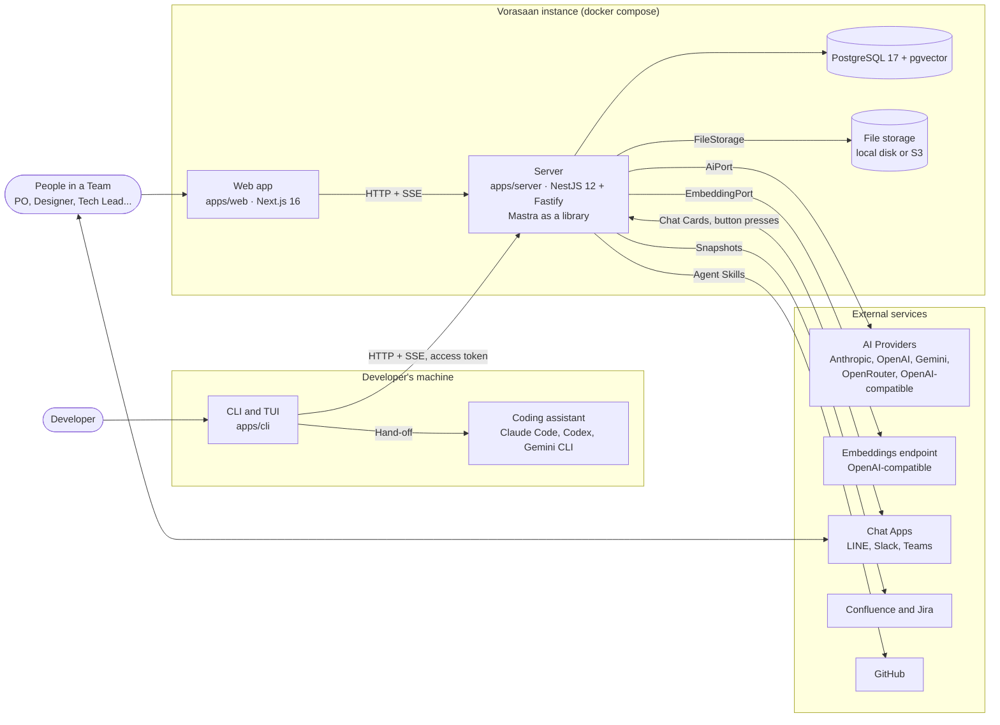
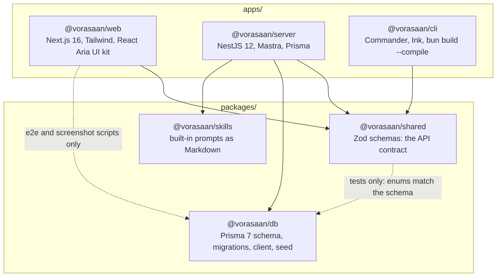
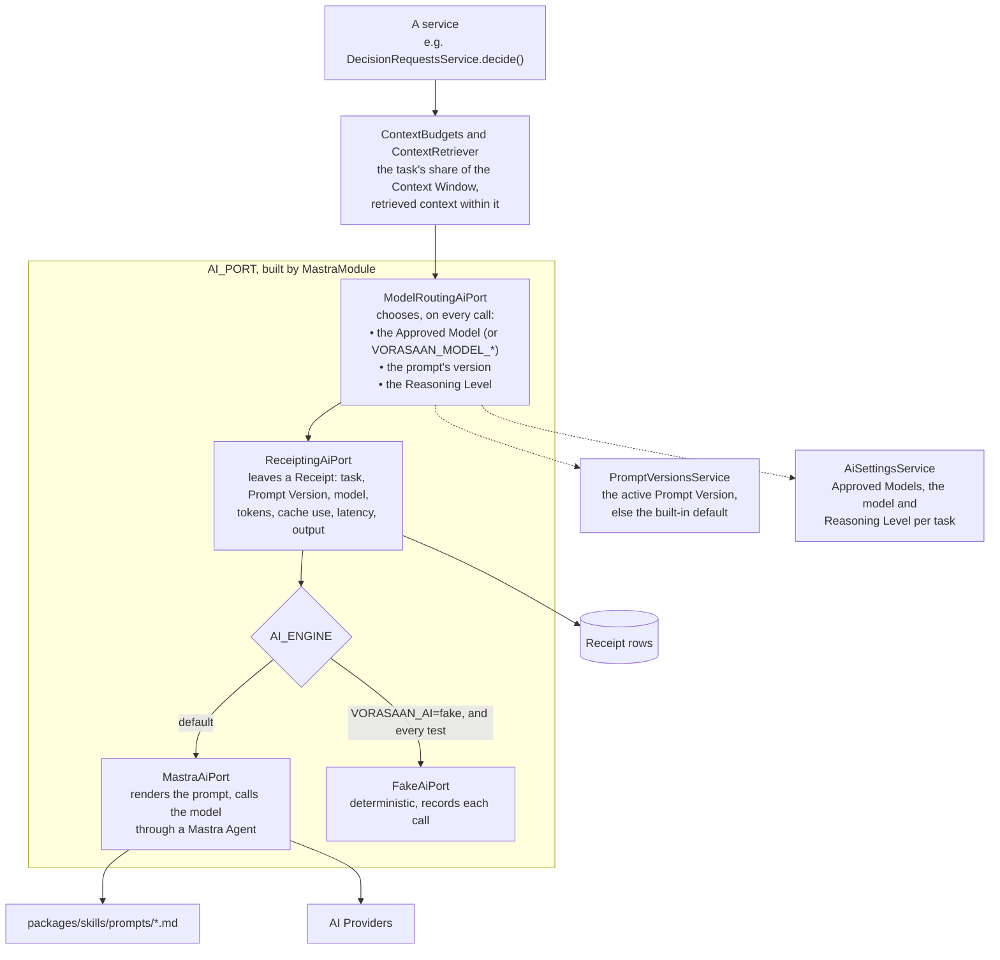
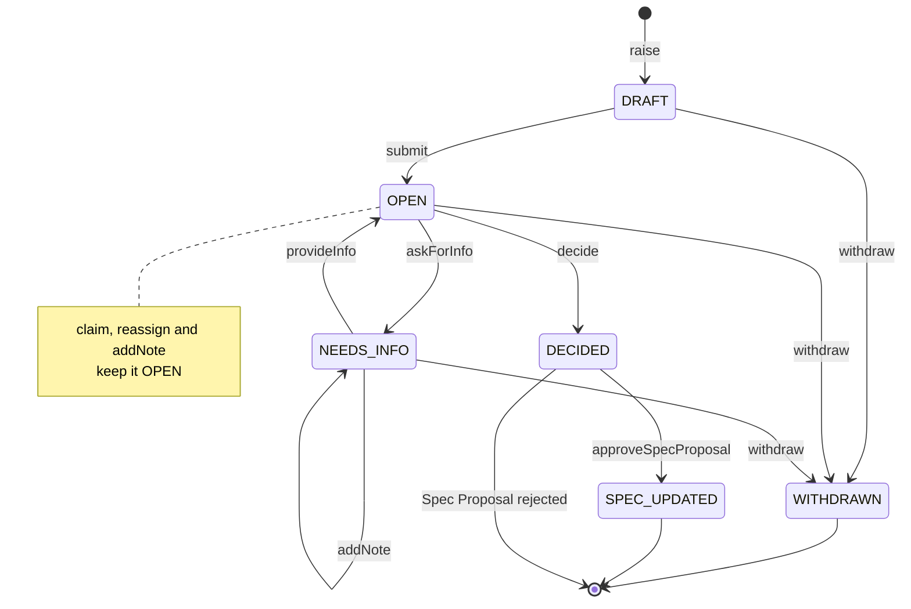
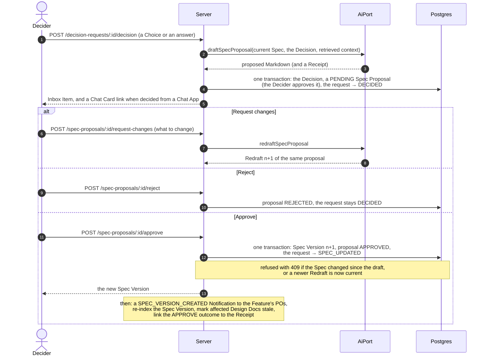

# Architecture

How Vorasaan is put together: what runs where, how the packages depend on each other, how an AI call travels, and the two flows at the heart of the product. The words used here (Feature, Spec, Decision Request, Decider...) are defined in [`CONTEXT.md`](../CONTEXT.md); the decisions behind the design are the [ADRs](./adr/).

- [System context](#system-context)
- [Monorepo layout](#monorepo-layout)
- [AI call path](#ai-call-path)
- [Decision Request lifecycle](#decision-request-lifecycle)
- [Spec Proposal: AI proposes, a person approves](#spec-proposal-ai-proposes-a-person-approves)

## System context

One Vorasaan instance serves one Organization. The **server** holds every rule and all the data; the web app and the CLI are clients of its HTTP API. Self-hosting is one `docker compose up`: the `db`, `server` and `web` services in [`docker-compose.yml`](../docker-compose.yml).

- **Web app.** Server-rendered pages call the API on behalf of the signed-in person (their sign-in cookie, forwarded as a bearer token); live updates reach the browser through the web app's `/api/events` stream, which relays the server's.
- **CLI.** `vorasaan raise` and the TUI use the same API with a personal access token. `vorasaan run` asks the server for a Feature's Hand-off, writes it to `.vorasaan/specs/` and starts the coding assistant on it.
- **AI Providers** are connected by an Admin with the Organization's own keys, stored encrypted with `VORASAAN_SECRET_KEY` ([ADR 0010](./adr/0010-approved-models-and-the-chat-picker.md)). Every call goes through `AiPort` (below).
- **Retrieval.** Specs, Decisions and Attachment Snapshots are cut into chunks and embedded into pgvector, so each AI task gets only the relevant context within its token budget ([ADR 0007](./adr/0007-retrieval-with-pgvector.md), [ADR 0012](./adr/0012-context-budgets-and-auto-compaction.md)).
- **Chat Apps** get Chat Cards for Decision Requests and send button presses back to `POST /chat-apps/:provider/events` ([ADR 0011](./adr/0011-response-windows-and-deciding-from-chat-apps.md)).
- **Confluence and Jira** are read only: their pages become Attachments with a Snapshot, and a Feature may link to a Jira Epic. Vorasaan's Spec, not Confluence, is the source of truth ([ADR 0001](./adr/0001-vorasaan-is-the-source-of-truth.md)).
- **Agent Skills** are fetched from GitHub (or uploaded as a zip), pinned, and stored through `FileStorage`; nothing in them is run ([ADR 0017](./adr/0017-agent-skills-installable-skill-md-packages.md)).

## Monorepo layout

One Bun monorepo, with Turborepo running the tasks ([ADR 0005](./adr/0005-bun-as-runtime-and-package-manager.md)). The packages in `packages/*` export their TypeScript source; there is no build step for them.

| Package | What it holds |
| --- | --- |
| `apps/server` | The API, every domain rule, the background jobs (indexing, escalation, Chat Card delivery, Design Docs) and the AI. One NestJS module per area: `decision-requests`, `spec`, `conversations`, `ai`, `receipts`, `retrieval`, `chat-apps`... |
| `apps/web` | The chat-first web app ([ADR 0008](./adr/0008-chat-first-web-ui.md)): the Sidebar, Conversations with Action Cards, Inbox, Feature and Project pages, Settings. Its UI kit is in `components/ui/` ([ADR 0016](./adr/0016-ui-kit-on-react-aria-components.md)). |
| `apps/cli` | `vorasaan` commands (`login`, `init`, `raise`, `scan`, `run`) and the TUI. Builds to a single binary. |
| `packages/shared` | One Zod schema per request and response. The server validates with it, and the web app and CLI import the same schema and type ([ADR 0004](./adr/0004-zod-is-the-only-api-contract.md)). |
| `packages/db` | `schema.prisma`, the migrations, `createPrismaClient()` and the demo seed. |
| `packages/skills` | One Markdown prompt per AI task, with shared partials such as the language rules. These are Vorasaan's built-in prompts, not Agent Skills. |

Solid arrows are runtime dependencies; dotted ones are development-only (`devDependencies`).

## AI call path

Services never talk to a provider. They call `AiPort` (`apps/server/src/ai/ai.port.ts`), and `MastraModule` ([ADR 0003](./adr/0003-mastra-as-a-library-inside-nestjs.md)) builds the port as three layers, so every call is routed, recorded and then made:

1. **Budget and context.** The service asks `ContextBudgets` for the task's model and budget, then retrieves context within it.
2. **`ModelRoutingAiPort` chooses**, on every call, so a change in Settings applies to the next one:
   - the **model**: the caller's pick (the chat's model picker), else the task's Approved Model, else the Organization default; a `VORASAAN_MODEL_<TASK>` env var wins ([ADR 0010](./adr/0010-approved-models-and-the-chat-picker.md));
   - the **prompt's version**: the Organization's active **Prompt Version** of that prompt, else the built-in default from `packages/skills` ([ADR 0015](./adr/0015-learning-loop-humans-change-the-ai.md));
   - the **Reasoning Level**: "Think deeper" on a chat message, else `VORASAAN_REASONING*`, else the Admin's setting for the task, else the task's default; each provider gets its own setting for it.
3. **`ReceiptingAiPort`** leaves a **Receipt** for every call, failed ones included. When people later approve, decline, Request changes on or edit what the call produced, that outcome is linked to its Receipt. Receipts feed Settings → AI usage, Feedback Analysis and Replay.
4. **The engine** makes the call. `MastraAiPort` renders the task's prompt (the Prompt Version's template, or the Markdown in `packages/skills/prompts/`, with the language rules partial), cuts it at `{{cacheBreak}}` for prompt caching, and calls the model through Mastra. With `VORASAAN_AI=fake`, and in every test, `FakeAiPort` answers instead; tests keep the routing and Receipt layers above it.

Embeddings take a parallel path through `EmbeddingPort` (an OpenAI-compatible adapter, or a fake). Prompt quality is checked by evals run by hand (`bun run --cwd apps/server eval:*`) and by Eval Runs in the app; see [CONTRIBUTING](../CONTRIBUTING.md#tests-and-the-ai).

## Decision Request lifecycle

The states and transitions are one table in [`decision-request.state.ts`](../apps/server/src/decision-requests/decision-request.state.ts); any other move is refused with `InvalidTransitionError`. A Decision Request is a Blocker or a Question (`kind`); both follow the same states.

| Event | Who | What happens |
| --- | --- | --- |
| `raise` | Raiser | The request is created as `DRAFT`. The AI drafts 2 to 4 Choices, unless it is a Question asked as plain text. |
| `submit` | Raiser | After reviewing (and editing) the Choices, the Raiser picks the Recipients and sends it. |
| `claim` | someone holding the request's Team Role | They become the Decider; the state stays `OPEN`. |
| `reassign` | Decider | Hands it to someone else with that Team Role; the state stays `OPEN`. |
| `askForInfo`, `provideInfo` | Decider, Raiser | The Decider asks the Raiser a question; the Raiser's answer returns it to `OPEN`. |
| `addNote` | Raiser or Decider | Adds to the request's thread without changing the state. |
| `decide` | Decider | A Choice or a free-text answer; the AI drafts a Spec Proposal from it (below). |
| `approveSpecProposal` | the person the Spec Proposal awaits (the Decider) | The Spec Proposal became a new Spec Version. |
| `withdraw` | Raiser | Any time before a Decision. |

- **Who decides.** A request sent to one Role Owner has that person as its Decider. One sent to all Role Owners of a Team Role has no Decider until someone **Claims** it; deciding it Claims it implicitly. `claim` and `reassign` change the Decider, never the state, and only while `OPEN`. The Decider is never the Raiser.
- **Delegation and escalation** never change the state either. A Delegate becomes a Recipient and decides on the delegator's behalf; when the Response Window runs out, the escalation reminds, adds Delegates and reports the request overdue ([ADR 0011](./adr/0011-response-windows-and-deciding-from-chat-apps.md)).
- **Where it is decided.** The web app, the CLI or a Chat App; the Decision records which.
- **`DECIDED` is final** when the Spec Proposal it produced is rejected. While any Blocker on a Feature is open, the Feature is Blocked.

## Spec Proposal: AI proposes, a person approves

Nothing the AI writes becomes part of the Spec until a person approves it ([ADR 0001](./adr/0001-vorasaan-is-the-source-of-truth.md), [ADR 0008](./adr/0008-chat-first-web-ui.md), [ADR 0013](./adr/0013-request-changes-redrafts-proposals.md)). The main path starts from a Decision, in `DecisionRequestsService.decide()` and `SpecService.approve()`:

- **The same rule everywhere.** A Spec Proposal can also come from a Conversation's Action Card, from Attachments or as a Platform's acceptance criteria; Brief Proposals, Feature Suggestions, Design Docs ([ADR 0014](./adr/0014-design-docs-derived-from-the-spec-per-platform.md)) and Prompt Versions ([ADR 0015](./adr/0015-learning-loop-humans-change-the-ai.md)) follow the same pattern: the AI drafts, a named person approves, Request changes, or declines.
- **Only the person it awaits acts.** Anyone else gets a 403. Request changes keeps the same proposal and numbers each Redraft; Approve applies only the Redraft that was current.
- **Spec Versions are immutable** Markdown snapshots ([ADR 0002](./adr/0002-markdown-is-the-canonical-spec-format.md)), each approved by a named person, and each Decision in the Decision Log links to the Spec Version it produced.
